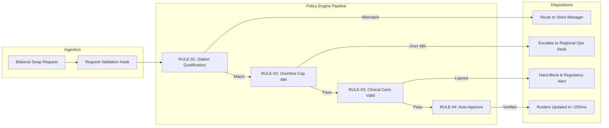

# Shiftwell: Rules-Based Auto-Approval Engine
### HugoHub / Hubspark Product Management Intern Case Study (2026–2027)

[](https://elaborate-parfait-1cc881.netlify.app/)
[](./Shiftwell_Product_Intern_Case_Study_Submission.pdf)
[](./docs/PRD_Rules_Engine.md)
[](https://github.com/krishnamurthi-ramesh)

---

## 📌 Executive Overview & Core Problem

**Shiftwell** is a multi-tenant B2B hourly workforce scheduling platform managing **8 active enterprise accounts across 620 locations and INR 4.08 Cr in ARR**. In Q4 2026, our three largest customers submitted divergent, urgent feature requests totaling 6 engineering sprints (100% capacity):
1. **FreshBowl (INR 84L ARR, Jan 2027 Renewal):** Demanded a WhatsApp bot for swap requests.
2. **UrbanMart (INR 110L ARR, Aug 2027 Renewal):** Demanded a custom 48-hour overtime restriction.
3. **CarePoint Clinics (INR 60L ARR, Dec 2026 Renewal):** Demanded clinical certification tracking.

### The Diagnostic: Approval Latency Drives Churn, Not Communication Channels
A comprehensive audit of customer transcripts, exit interviews, and historical churn data revealed the fundamental truth:

$$\text{Leading Indicator of Churn} = \text{Manager Approval Speed (<24 hours)}$$

- **Healthy Accounts** (UrbanMart, QuickKart, MedAxis): **70%** of swaps approved in <24 hours (manager workload: 2.5–3.5 hrs/wk).
- **At-Risk Accounts** (FreshBowl, CarePoint, FitZone, Brew & Co): Only **34%** of swaps approved in <24 hours (manager workload: 5.5–7.0 hrs/wk).
- **Churned Accounts** (TandooriTown 24%, GreenLeaf 31%, PawsCare 31%): Averaged **28.7%** approval speed.

> **Why Competitor RotaPro Won GreenLeaf (INR 55L ARR):**  
> *"Honestly it wasn't WhatsApp. Our managers couldn't keep up with approvals, and RotaPro let swaps go through automatically if the person was trained."*

WhatsApp merely relocates a manual queue of 30 notifications per night from mobile app to chat; it does nothing to clear the bottleneck.

---

## 🎯 The Strategic Recommendation: Build the Rules Engine in 4 Sprints

Instead of building 3 disparate, brittle one-offs that consume 100% of capacity with 0 contingency:

1. **Build a Reusable Rules-Based Auto-Approval Engine (4 Sprints Total):**
   - **3 Sprints:** Core Rules Engine (Role & station match, 48h overtime threshold, and instant <200ms auto-approval).
   - **1 Sprint:** Clinical Certificate Enforcement Module (secures CarePoint's INR 60L Dec renewal).
   - **2 Sprints Buffer:** Preserved for QA, edge cases, integration testing, and pilot rollouts.
2. **Defer WhatsApp to Q1 2027:** Re-evaluate strictly as an escalation notification channel once routine swaps are auto-resolved.
3. **Economics:** Protects **INR 1.84 Cr in at-risk ARR**, cuts manager administrative load by **~65%**, and avoids **INR 76,900–INR 1,15,400/yr** in variable WhatsApp API surcharges.

---

## 🗂 Key Repository Deliverables & Artifacts

| Document / Artifact | Description | Link |
| :--- | :--- | :--- |
| 📄 **Executive Memo to CEO & Brief Deliverables** | 4-page master LaTeX document covering the CEO Memo (strictly 2 pages), Reply to Sales Head (184 words), Assumptions List, and Build Note. | [**View Master PDF**](./Shiftwell_Product_Intern_Case_Study_Submission.pdf) |
| 📋 **Product Requirements Document (PRD)** | Industry-standard PRD detailing user personas, functional specifications, rule precedence hierarchy, and release milestones. | [**View PRD**](./docs/PRD_Rules_Engine.md) |
| 📊 **Quantitative Churn & Economic Model** | Deep dive into portfolio metrics, churn inflection threshold (<35%), and WhatsApp unit economics. | [**View Diagnostic**](./docs/CHURN_DATA_DIAGNOSTIC.md) |
| 🚀 **Live Deployed Web Application** | Production-grade B2B SaaS prototype built with semantic HTML5, Linear/Stripe design tokens, and sub-millisecond execution. | [**Launch Prototype**](https://elaborate-parfait-1cc881.netlify.app/) |
| 📑 **LaTeX Source Code** | Clean, scalable LaTeX source compiled with scalable Latin Modern typography and microtype kerning. | [**View Source**](./Shiftwell_Product_Intern_Case_Study_Submission.tex) |

---

## ⚙️ Prototype Architecture & System Design



### Prototype Capabilities
- **Tenant Context Switcher:** Switch between **FreshBowl** (120 locs), **CarePoint Clinics** (40 locs), **UrbanMart** (200 locs), and **Global Default** in the top navigation bar to observe policies adapt dynamically.
- **5 Canonical Simulation Scenarios:**
  - *FreshBowl Line Cook Swap:* Auto-approved instantly in 142ms.
  - *CarePoint Expired BLS Nurse:* Hard-blocked in 88ms to prevent INR 5,00,000 regulatory penalties.
  - *UrbanMart Overtime Breach:* Escalated to Regional Manager with 1-click authorization and INR 1,350 overtime cost projection.
  - *FreshBowl Station Cook Overtime:* Minor breach escalated to Store Manager.
  - *CarePoint Validated ICU Nurse:* Full clinical compliance auto-approved in 178ms.
- **Interactive Custom Sandbox:** Configure custom roles, weekly hours, and credential validity live to test arbitrary policy edge cases.
- **Multi-View Decision Inspector:**
  - **Decision Summary:** Reason code, latency benchmarks, and compliance status.
  - **Frontline Mobile Preview:** Native smartphone card preview.
  - **Manager Action Desk:** Silent daily summary digest or 1-click authorization desk.
  - **JSON Audit Ledger:** Collapsible immutable JSON trace with cryptographic IDs and timestamps.

---

## 📊 Portfolio Summary Data

| Account Name | Segment | Locations | ARR | Renewal | Approval <24h | Manager Load | Status |
| :--- | :--- | :---: | :---: | :---: | :---: | :---: | :--- |
| **UrbanMart** | Retail | 200 | INR 110L | Aug 2027 | 64% | 3.5 hrs/wk | Healthy (Flagship) |
| **FreshBowl** | Restaurants | 120 | INR 84L | Jan 2027 | 38% | 6.5 hrs/wk | **At Risk (Gridlock)** |
| **CarePoint Clinics** | Healthcare | 40 | INR 60L | Dec 2026 | 71% | 4.0 hrs/wk | **At Risk (Audit Risk)** |
| **QuickKart** | Retail | 90 | INR 48L | Jun 2027 | 67% | 3.0 hrs/wk | Healthy |
| **Spice Route** | Restaurants | 60 | INR 36L | Mar 2027 | 41% | 6.0 hrs/wk | Watchlist |
| **MedAxis Labs** | Healthcare | 25 | INR 30L | Feb 2027 | 80% | 2.5 hrs/wk | Healthy |
| **FitZone** | Gyms | 50 | INR 22L | Oct 2026 | 35% | 5.5 hrs/wk | **At Risk (Gridlock)** |
| **Brew & Co** | Cafes | 35 | INR 18L | Nov 2026 | 29% | 7.0 hrs/wk | **At Risk (Gridlock)** |
| **Total Active (8)** | **--** | **620** | **INR 408L** | **--** | **Avg 53.1%** | **Avg 4.75 hrs/wk** | **INR 184L At Risk** |

---

## 🚀 How to Run Locally

```bash
# 1. Clone the repository
git clone https://github.com/krishnamurthi-ramesh/shiftwell-prototype.git

# 2. Navigate to project root
cd shiftwell-prototype

# 3. Start a local server
python -m http.server 8080 --directory prototype

# 4. Open in browser: http://localhost:8080
```

---

## 👤 Candidate Information

- **Candidate:** Krishna Murthi
- **Role Application:** Product Management Intern (2026–2027)
- **Organization:** HugoHub / Hubspark Selection Process
- **Submission Google Form:** [https://forms.gle/CcgPk9PnNyqSyy51A](https://forms.gle/CcgPk9PnNyqSyy51A)
- **GitHub:** [@krishnamurthi-ramesh](https://github.com/krishnamurthi-ramesh)
