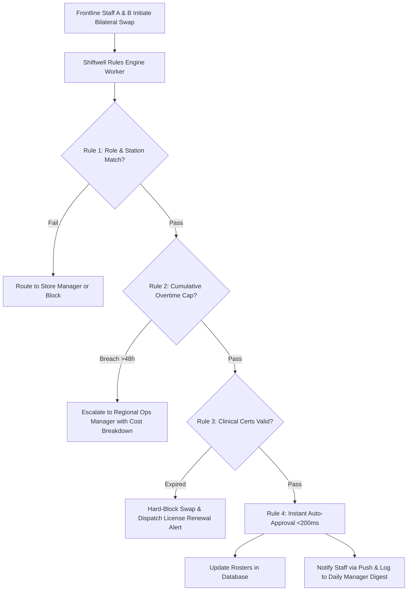

# Product Requirements Document (PRD): Shiftwell Smart Swap Rules Engine

| **Document Metadata** | **Specification** |
| :--- | :--- |
| **Product** | Shiftwell Enterprise Workforce Management |
| **Feature / Epic** | Rules-Based Auto-Approval Engine & Compliance Safeguards |
| **Author** | Krishna Murthi (Product Management Intern Candidate) |
| **Target Release** | Q4 2026 (Sprints 1–4 Proposed Build, Sprints 5–6 Hardening Buffer) |
| **Status** | Candidate Proposed Specification (Subject to Engineering Lead Validation) |
| **Target Accounts** | FreshBowl (INR 84L), CarePoint Clinics (INR 60L), UrbanMart (INR 110L), Portfolio-wide |

---

## 1. Executive Summary & Problem Definition

### 1.1 The Context
Shiftwell is a multi-tenant B2B SaaS platform managing hourly workforce scheduling across retail, restaurant, and healthcare enterprises (8 active accounts, 620 locations, INR 4.08 Cr ARR). In Q4 2026, our three largest enterprise customers submitted divergent, urgent feature requests:
- **FreshBowl (INR 84L ARR, Jan 2027 Renewal):** Demands WhatsApp bot integration for swap requests.
- **UrbanMart (INR 110L ARR, Aug 2027 Renewal):** Demands strict overtime prevention rules (capping weekly hours at 48h).
- **CarePoint Clinics (INR 60L ARR, Dec 2026 Renewal):** Demands clinical license/certification expiration blocking.

### 1.2 The Core Diagnosis & "Why Not WhatsApp?"
Sales recommended building all 3 requested custom features (consuming 6/6 sprints, 100% engineering capacity). However, an empirical audit of customer interview logs and churn records reveals:
- **Root Cause Risk Signal:** Existential churn risk strongly correlates with **manager approval latency**, not delivery channels.
  - Accounts with **>60%** swaps approved within 24 hours are **Healthy** (UrbanMart 64%, QuickKart 67%, MedAxis 80%).
  - The three accounts suffering from acute approval bottlenecks (FreshBowl 38%, FitZone 35%, Brew & Co 29%) average only **34%** approval speed within 24 hours (manager workload: 5.5–7.0 hrs/wk).
  - CarePoint Clinics (71% approval speed, 4.0 hrs/wk) is at risk separately due to **regulatory audit exposure** (uncredentialed shifts), not approval latency.
- **Why Competitor RotaPro Won GreenLeaf (INR 16L ARR):** GreenLeaf’s exit interview explicitly confirmed:
  > *"Honestly it wasn't WhatsApp. Our managers couldn't keep up with approvals, and RotaPro let swaps go through automatically if the person was trained."*
- **WhatsApp Fallacy:** WhatsApp is a message conduit, not a decision engine. Routing 30 notifications per night to an overwhelmed store manager on WhatsApp does not eliminate the bottleneck; it merely relocates burnout to personal chat.

---

## 2. Strategic Objectives & Success Metrics

### 2.1 Objectives
1. **Address At-Risk Portfolio Churn:** Address operational gridlock and regulatory audit risk across **INR 1.84 Cr** in exposed renewal ARR (FreshBowl, CarePoint, FitZone, Brew & Co). Note: This represents exposed ARR requiring retention intervention, not guaranteed revenue saved.
2. **Reduce Operational Friction:** Target reducing store manager routine scheduling burden (FreshBowl baseline: 6.5 hrs/wk), aiming for ~4.2 hrs/wk saved as a pilot hypothesis.
3. **Neutralize Competitor Moat:** Deliver an automated rules engine without incurring recurring WhatsApp Business API fees (saving an estimated INR 85,300–INR 1,28,000 annually across 10,160 monthly swaps).
4. **Preserve Engineering Buffer:** Target shipping the unified engine in **4 sprints**, preserving **2 full sprints** for integration testing, edge cases, and pilot rollouts (subject to engineering lead sizing).

### 2.2 Key Performance Indicators (KPIs)

| Metric Type | Metric Name | Current Baseline | Target Post-Launch (Pilot Hypothesis) |
| :--- | :--- | :--- | :--- |
| **Operational Primary** | **Swap Approval Speed (<24h)** | 49% Portfolio Avg (34% high-friction avg) | **> 70% resolved in <24h** |
| **Automation Target** | **Routine Auto-Approval Share** | 0% (All swaps manual) | **Targeting up to 75% instant (<200ms)** |
| **Retention Goal** | At-Risk ARR Retention | INR 1.84 Cr exposed across 4 accounts | **Maximize renewal retention with CS alignment** |
| **Workload Hypothesis** | Manager Weekly Scheduling Load | 4.75 hrs/wk avg (6.5h at FreshBowl) | **Target ~4.2 hrs/wk reduction at FreshBowl** |
| **Quality & Compliance** | Uncredentialed Clinical Shifts Covered | 2 shifts flagged (CarePoint) | **0 (Hard-blocked by engine)** |
| **Engine Performance** | Evaluation Latency | N/A (14–24 hours manual sign-off) | **< 200ms simulated / local worker** |

---

## 3. User Personas & Core Journeys

### 3.1 Persona Profiles
1. **Frontline Shift Worker (e.g., Rahul - Line Cook):** Needs to swap Saturday night shift quickly. Currently waits 18+ hours for store manager sign-off; frequently drops shifts if unanswered.
2. **Location Store Manager (e.g., Rohit - Store #104 Manager):** Receives 25–30 swap requests every evening. Approves 80% blindly without checking station training or overtime. Experiences chronic operational fatigue.
3. **Regional Operations Manager (e.g., Rajesh - VP Retail):** Wants to prevent uncontrolled 1.5x overtime wage runups across 200 stores. Demands proactive escalation only when a swap exceeds 48 hours.
4. **Clinical Nursing Supervisor (e.g., Dr. Ananya - CarePoint):** Responsible for clinical audit compliance. Terrified of uncredentialed nurses covering ICU shifts and incurring INR 5,00,000 regulatory penalties.

---

## 4. Functional Specifications & Rule Precedence

The engine evaluates incoming swap requests sequentially. The evaluation precedence hierarchy is strictly ordered to prevent safety breaches before evaluating operational preferences:

$$\text{Hard-Block (Regulatory)} \longrightarrow \text{Escalate (Labor Cost)} \longrightarrow \text{Auto-Approve (Operational)}$$

### 4.1 RULE-01: Role & Station Qualification Check
- **Scope:** All accounts (Restaurant, Retail, Healthcare).
- **Behavior:**
  - Evaluates whether the replacement candidate possesses verified training for the specific station/unit (e.g. *Grill Station A*, *Express POS Terminal*, *ICU Ward*).
  - Configurable action on mismatch: `ROUTE_TO_LOCATION_MANAGER` (standard restaurant mode) or `HARD_BLOCK` (strict clinical mode).
- **Default Parameter:** Require exact station certification match.

### 4.2 RULE-02: Overtime Threshold & Labor Compliance Cap
- **Scope:** UrbanMart requirement, applicable portfolio-wide.
- **Behavior:**
  - Calculates cumulative projected hours: $\text{Current Weekly Hours} + \text{Target Shift Duration}$.
  - If $\text{Projected Hours} > 48\text{ hrs}$ (or tenant-configured cap):
    - Trigger `ACTION_ESCALATE_REGIONAL_MGR`.
    - Calculate projected overtime expense ($\Delta \text{Hours} \times 1.5 \times \text{Base Wage}$).
    - Dispatch push alert to Regional Manager with 1-click authorize/decline buttons.
- **Default Parameter:** Cap = 48.0 hours/week.

### 4.3 RULE-03: Clinical & Regulatory Certificate Validity
- **Scope:** CarePoint Clinics requirement, healthcare segment.
- **Behavior:**
  - Checks expiration dates for all mandatory credentials associated with the target role (e.g. Basic Life Support - BLS, Nursing Council Registration, Food Handler Safety - FSSAI).
  - If $\text{Expiration Date} \le \text{Shift Date}$:
    - Trigger `ACTION_HARD_BLOCK`.
    - Log compliance violation attempt to audit log.
    - Dispatch alert to candidate with direct link to credential renewal portal.
- **Default Parameter:** Strict enforcement on all statutory certifications; 30-day advance expiry warning alert.

### 4.4 RULE-04: Zero-Touch Instant Auto-Approval
- **Scope:** Portfolio-wide.
- **Behavior:**
  - If all active rules evaluate to `PASS`:
    - Atomically update schedule database in `< 200ms`.
    - Dispatch native push notifications to both workers.
    - Suppress instant notification to Location Manager; append event to the **11:00 PM Daily Manager Digest**.

---

## 5. Non-Functional & Architecture Requirements

1. **Performance:** Rule evaluation pipeline must execute with $P_{95} \le 200\text{ms}$.
2. **Multi-Tenancy:** Each enterprise account must support tenant-level rule parameter overrides without code redeployment.
3. **Auditability:** Every rule execution must generate an immutable, structured JSON audit record containing `trace_id`, `tenant_id`, `actor_ids`, `individual_rule_results`, and `final_disposition`.
4. **Decoupling:** Decouple mobile app from business logic. The mobile client only displays new status tokens (`AUTO_APPROVED`, `ESCALATED`, `BLOCKED`).

---

## 6. Sprint Capacity Allocation (Total: 6 Sprints)

| Sprint Cycle | Engineering Focus | Deliverables | Risk Buffer |
| :--- | :--- | :--- | :--- |
| **Sprint 1** | Pipeline Core & Data Interceptor | Request interceptor, evaluation hook, state machine. | None |
| **Sprint 2** | Role Matching & Overtime Service | Station certification matrix, cumulative hours calculator. | None |
| **Sprint 3** | Escalation Desk & Digest Service | Regional manager 1-click webhook, daily digest batcher. | None |
| **Sprint 4** | Certificate Expiry Module | Credential schema extension, date validation hook (CarePoint). | None |
| **Sprint 5** | Integration Testing & Edge Cases | Race conditions, timezone discrepancies, multi-store swaps. | **1 Full Sprint Buffer** |
| **Sprint 6** | Pilot Rollout & Hardening | 10-store FreshBowl pilot, CarePoint audit validation. | **1 Full Sprint Buffer** |

**Total Build:** 4 Sprints &nbsp;|&nbsp; **Contingency Buffer:** 2 Full Sprints (33% safety margin).

---

## 7. Account-by-Account Stakeholder Communication Plan

- **FreshBowl (INR 84L ARR, Jan 2027 Renewal):**
  > *"We investigated your frontline feedback. WhatsApp still leaves store managers with dozens of manual approvals. Instead, our Q4 engineering commitment is instant Auto-Approval for trained station staff. By targeting automation of roughly 75% of routine requests, we project saving managers ~4.2 hours weekly (a ~65% reduction from their current 6.5 hrs/week), aiming to reduce shift dropouts and speed up coverage during peak dinner rushes, subject to validation in our upcoming store pilot."*
- **CarePoint Clinics (INR 60L ARR, Dec 2026 Renewal):**
  > *"We are addressing your regulatory audit exposure directly. We are committing Q4 engineering capacity to ship an integrated Certificate Expiry Enforcement Module that hard-blocks staff with expired BLS or Council credentials from scheduling or swapping, replacing manual spreadsheet tracking with automated system guardrails."*
- **UrbanMart (INR 110L ARR, Aug 2027 Renewal):**
  > *"We are building the overtime governance controls you requested. Our Q4 Rules Engine build will introduce a configurable 48-hour weekly cap that automatically routes breaching swaps to Regional Managers for 1-click authorization."*

---

## 8. Critical Data Dependencies, Engineering Validation & Safe Fallbacks

### 8.1 Key Data Dependencies
1. **Verified Station & Skill Records:** Auto-approval requires that individual staff station qualification records (e.g., Line Cook Station Certified) are populated and verified in the database.
   - **Safe Fallback Policy:** If station or training data is missing, expired, or ambiguous, the engine must **never** treat it as a pass. It automatically falls back to `ROUTE_TO_LOCATION_MANAGER` for manual human evaluation.
2. **Cumulative Weekly Hours Calculation:** Overtime threshold checks require synchronized shift duration and clock-in history.
   - **Concurrency Safety:** Race conditions (e.g. concurrent bilateral swap submissions) are mitigated via distributed locking on the shift ID to prevent double-swapping and overtime blindspots.
3. **Escalation Role & Permissions:** The 48h escalation desk assumes a Regional Operations Manager or Store General Manager role exists with approval authority. If undefined for an account, escalations default to the primary Account Owner / Store GM.

### 8.2 Engineering Sizing Validation & Capacity Governance
- **Core Engine Sizing (Planning Assumption):** The 3-sprint core engine estimate is a proposed candidate assumption. Prior to sprint commitment, this must be validated with the Engineering Lead.
- **Capacity Governance & Scope Trade-offs:** If technical debt or integration discovery pushes the core engine beyond 3 sprints:
  1. *Priority 1 (Must-Ship):* CarePoint Certificate Expiry Module (hard regulatory renewal deadline in Dec 2026).
  2. *Priority 2 (Must-Ship):* Core Rules Framework with basic overtime hard-stop.
  3. *Scope Deferral Option:* Defer complex multi-tier escalation dashboards or rich digest services to Q1 2027 rather than compromising the 2-sprint testing buffer.

