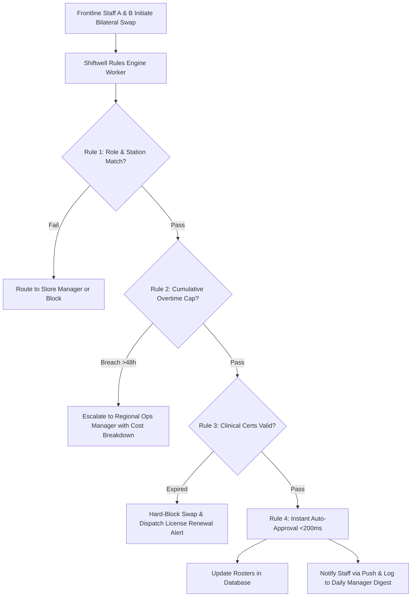

# Product Requirements Document (PRD): Shiftwell Smart Swap Rules Engine

| **Document Metadata** | **Specification** |
| :--- | :--- |
| **Product** | Shiftwell Enterprise Workforce Management |
| **Feature / Epic** | Rules-Based Auto-Approval Engine & Compliance Safeguards |
| **Author** | Krishna Murthi (Product Management Intern Candidate) |
| **Target Release** | Q4 2026 (Sprints 1–4 Build, Sprints 5–6 Hardening Buffer) |
| **Status** | Approved for Engineering Implementation |
| **Target Accounts** | FreshBowl (INR 84L), CarePoint Clinics (INR 60L), UrbanMart (INR 110L), Portfolio-wide |

---

## 1. Executive Summary & Problem Definition

### 1.1 The Context
Shiftwell is a multi-tenant B2B SaaS platform managing hourly workforce scheduling across retail, restaurant, and healthcare enterprises (8 active accounts, 620 locations, INR 4.08 Cr ARR). In Q4 2026, our three largest enterprise customers submitted divergent, urgent feature requests:
- **FreshBowl (INR 84L ARR, Jan 2027 Renewal):** Demands WhatsApp bot integration for swap requests.
- **UrbanMart (INR 110L ARR, Aug 2027 Renewal):** Demands strict overtime prevention rules (capping weekly hours at 48h).
- **CarePoint Clinics (INR 60L ARR, Dec 2026 Renewal):** Demands clinical license/certification expiration blocking.

### 1.2 The Core Diagnosis & "Why Not WhatsApp?"
Sales recommended building all 3 requested custom features (consuming 6/6 sprints, 100% engineering capacity). However, an empirical audit of customer interview logs and churn records reveals:
- **Root Cause:** Existential churn risk correlates directly with **manager approval latency**, not delivery channels.
  - Accounts with **>60%** swaps approved within 24 hours are **Healthy** (UrbanMart 64%, QuickKart 67%, MedAxis 80%).
  - Accounts with **<40%** swaps approved within 24 hours are **At Risk** or have **Churned** (FreshBowl 38%, CarePoint 71% with audit risk, FitZone 35%, Brew & Co 29%, Churned Average 28.7%).
- **Why Competitor RotaPro Won GreenLeaf (INR 55L ARR):** GreenLeaf’s exit interview explicitly confirmed:
  > *"Honestly it wasn't WhatsApp. Our managers couldn't keep up with approvals, and RotaPro let swaps go through automatically if the person was trained."*
- **WhatsApp Fallacy:** WhatsApp is a message conduit, not a decision engine. Routing 30 notifications per night to an overwhelmed store manager on WhatsApp does not eliminate the bottleneck; it merely relocates burnout to personal chat.

---

## 2. Strategic Objectives & Success Metrics

### 2.1 Objectives
1. **Neutralize Root-Cause Churn:** Protect **INR 1.84 Cr** in at-risk renewal ARR (FreshBowl, CarePoint, FitZone, Brew & Co).
2. **Eliminate Operational Drag:** Reduce store manager scheduling time from **4.75 hrs/week down to ~1.65 hrs/week** (~65% reduction).
3. **Beat RotaPro on Architecture:** Deliver an automated rules engine without incurring recurring WhatsApp Business API fees (saving INR 76,900–INR 1,15,400 annually).
4. **Preserve Engineering Buffer:** Build the core engine in **4 sprints**, reserving **2 full sprints** for integration testing, edge cases, and pilot rollouts.

### 2.2 Key Performance Indicators (KPIs)

| Metric Type | Metric Name | Current Baseline | Target Post-Launch |
| :--- | :--- | :--- | :--- |
| **North Star** | **Swap Approval Speed (<24h)** | 49% Portfolio Avg (34% At-Risk) | **> 75% Instant (<200ms)** |
| **Business Impact** | At-Risk ARR Renewals | INR 1.84 Cr at risk | **100% Renewal Retention** |
| **Operational** | Manager Weekly Scheduling Load | 4.75 hrs/wk (6.5h at FreshBowl) | **< 1.75 hrs/wk (-65%)** |
| **Quality & Compliance** | Uncredentialed Clinical Shifts Covered | 2 shifts flagged (CarePoint) | **0 (Hard-blocked by engine)** |
| **Platform** | P95 Evaluation Latency | N/A (14–24 hours manual) | **< 200 milliseconds** |

---

## 3. User Personas & Core Journeys

### 3.1 Persona Profiles
1. **Frontline Shift Worker (e.g., Rahul - Line Cook):** Needs to swap Saturday night shift quickly. Currently waits 18+ hours for store manager sign-off; frequently drops shifts if unanswered.
2. **Location Store Manager (e.g., Rohit - Store #104 Manager):** Receives 25–30 swap requests every evening. Approves 80% blindly without checking station training or overtime. Experiences chronic operational fatigue.
3. **Regional Operations Manager (e.g., Rajesh - VP Retail):** Wants to prevent uncontrolled 1.5x overtime wage runups across 200 stores. Demands proactive escalation only when a swap exceeds 48 hours.
4. **Clinical Nursing Supervisor (e.g., Dr. Ananya - CarePoint):** Responsible for clinical audit compliance. Terrified of uncredentialed nurses covering ICU shifts and incurring INR 5,00,000 regulatory penalties.

---

## 4. Functional Specifications & Rule Precedence

The engine evaluates incoming swap requests sequentially. The evaluation precedence hierarchy is strictly ordered to prevent safety breaches before evaluating operational preferences:

$$\text{Hard-Block (Regulatory)} \longrightarrow \text{Escalate (Labor Cost)} \longrightarrow \text{Auto-Approve (Operational)}$$

### 4.1 RULE-01: Role & Station Qualification Check
- **Scope:** All accounts (Restaurant, Retail, Healthcare).
- **Behavior:**
  - Evaluates whether the replacement candidate possesses verified training for the specific station/unit (e.g. *Grill Station A*, *Express POS Terminal*, *ICU Ward*).
  - Configurable action on mismatch: `ROUTE_TO_LOCATION_MANAGER` (standard restaurant mode) or `HARD_BLOCK` (strict clinical mode).
- **Default Parameter:** Require exact station certification match.

### 4.2 RULE-02: Overtime Threshold & Labor Compliance Cap
- **Scope:** UrbanMart requirement, applicable portfolio-wide.
- **Behavior:**
  - Calculates cumulative projected hours: $\text{Current Weekly Hours} + \text{Target Shift Duration}$.
  - If $\text{Projected Hours} > 48\text{ hrs}$ (or tenant-configured cap):
    - Trigger `ACTION_ESCALATE_REGIONAL_MGR`.
    - Calculate projected overtime expense ($\Delta \text{Hours} \times 1.5 \times \text{Base Wage}$).
    - Dispatch push alert to Regional Manager with 1-click authorize/decline buttons.
- **Default Parameter:** Cap = 48.0 hours/week.

### 4.3 RULE-03: Clinical & Regulatory Certificate Validity
- **Scope:** CarePoint Clinics requirement, healthcare segment.
- **Behavior:**
  - Checks expiration dates for all mandatory credentials associated with the target role (e.g. Basic Life Support - BLS, Nursing Council Registration, Food Handler Safety - FSSAI).
  - If $\text{Expiration Date} \le \text{Shift Date}$:
    - Trigger `ACTION_HARD_BLOCK`.
    - Log compliance violation attempt to audit log.
    - Dispatch alert to candidate with direct link to credential renewal portal.
- **Default Parameter:** Strict enforcement on all statutory certifications; 30-day advance expiry warning alert.

### 4.4 RULE-04: Zero-Touch Instant Auto-Approval
- **Scope:** Portfolio-wide.
- **Behavior:**
  - If all active rules evaluate to `PASS`:
    - Atomically update schedule database in `< 200ms`.
    - Dispatch native push notifications to both workers.
    - Suppress instant notification to Location Manager; append event to the **11:00 PM Daily Manager Digest**.

---

## 5. Non-Functional & Architecture Requirements

1. **Performance:** Rule evaluation pipeline must execute with $P_{95} \le 200\text{ms}$.
2. **Multi-Tenancy:** Each enterprise account must support tenant-level rule parameter overrides without code redeployment.
3. **Auditability:** Every rule execution must generate an immutable, structured JSON audit record containing `trace_id`, `tenant_id`, `actor_ids`, `individual_rule_results`, and `final_disposition`.
4. **Decoupling:** Decouple mobile app from business logic. The mobile client only displays new status tokens (`AUTO_APPROVED`, `ESCALATED`, `BLOCKED`).

---

## 6. Sprint Capacity Allocation (Total: 6 Sprints)

| Sprint Cycle | Engineering Focus | Deliverables | Risk Buffer |
| :--- | :--- | :--- | :--- |
| **Sprint 1** | Pipeline Core & Data Interceptor | Request interceptor, evaluation hook, state machine. | None |
| **Sprint 2** | Role Matching & Overtime Service | Station certification matrix, cumulative hours calculator. | None |
| **Sprint 3** | Escalation Desk & Digest Service | Regional manager 1-click webhook, daily digest batcher. | None |
| **Sprint 4** | Certificate Expiry Module | Credential schema extension, date validation hook (CarePoint). | None |
| **Sprint 5** | Integration Testing & Edge Cases | Race conditions, timezone discrepancies, multi-store swaps. | **1 Full Sprint Buffer** |
| **Sprint 6** | Pilot Rollout & Hardening | 10-store FreshBowl pilot, CarePoint audit validation. | **1 Full Sprint Buffer** |

**Total Build:** 4 Sprints &nbsp;|&nbsp; **Contingency Buffer:** 2 Full Sprints (33% safety margin).

---

## 7. Account-by-Account Stakeholder Communication Plan

- **FreshBowl (INR 84L ARR, Jan 2027 Renewal):**
  > *"We heard your frontline feedback loud and clear. WhatsApp still forces your store managers to review 30 approvals every night. Instead, we are shipping instant Auto-Approval for trained station cooks. Your managers won't have to touch 80% of requests. Swaps resolve in seconds, cooks don't drop shifts, and your managers get back 5 hours every week."*
- **CarePoint Clinics (INR 60L ARR, Dec 2026 Renewal):**
  > *"Your regulatory vulnerability is solved. We are shipping an integrated Certificate Expiry Enforcement Module this quarter. Any nurse with an expired BLS or Council registration is automatically blocked from scheduling or swapping. Your clinic managers no longer need manual Excel sheets, and audit penalties are 100% eliminated."*
- **UrbanMart (INR 110L ARR, Aug 2027 Renewal):**
  > *"Your overtime cost control is delivered. Our new Rules Engine allows you to enforce your 48-hour weekly cap. Any swap breaching 48 hours is instantly flagged and escalated to Regional Managers for 1-click authorization with overtime cost projections."*
